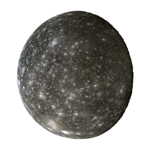

  

<h1 align="center">Kallisto Additions</h1>

<em>KGN specific additions</em>

| | |
| --- | --- |
| **Mod ID** | `mc-kallisto-additions` |
| **Minecraft** | 26.3 (Fabric) |
| **Environment** | Client & server |
| **Requires** | Fabric API, Fabric Language Kotlin |

## The idea

Kallisto Additions is a personal mod for the KGN friend group. Every member gets a signature item - a hat, a mustache, a paintbrush - that shows up on their character and comes with a small ability of its own, plus a couple of glowing plants to decorate the world with.

It is not meant to be balanced progression content: the items are handed out from the creative inventory and are there to make everyone recognizable and give them a little trick to use with friends.

## What it adds

All items live in the **KGN Additions** creative tab. There are no crafting recipes.

### Leya's Pinsel

A paintbrush that fights like a netherite sword and does not burn in lava or fire. Right-click it to sweep a wide arc of colorful smoke in front of you - a wall of drifting paint clouds in bright blues, purples, oranges, greens, yellows and pinks that slowly fades away.

### Michi's Tschäpper

A cap worn in the helmet slot. If you are at full health and a hit would kill you, the cap saves you instead: you survive with half a heart and hear the totem sound. This works automatically and then needs 5 minutes to recharge. Repaired with red wool.

### Luca's Beanie and Joel's Schnauz

Two more persona items, one for Luca and one for Joel. They share the same ability but each has its own look and 3D model on the player. While wearing either one, press the ability key to clear all your active effects - good and bad. The ability then has a 45-second cooldown. Luca's Beanie is repaired with gray wool, Joel's Schnauz with a nether star.

All three headwear items give the same protection as a netherite helmet's armor value, toughness and knockback resistance.

### Cannabeanikum Solaris and Moubatzius Lunar

Two decorative plants that work like a firefly bush. They glow, break instantly, can be walked through and drop themselves when broken.

## How to use

1. Open the **KGN Additions** tab in the creative inventory and take your item.
2. Put a hat or the mustache in your helmet slot, or hold Leya's Pinsel in your hand.
3. Use the ability: press **G** (the "Do Something" key, rebindable under *KGN Additions* in the controls) for the beanie and mustache, right-click with the paintbrush. Michi's Tschäpper triggers by itself.
